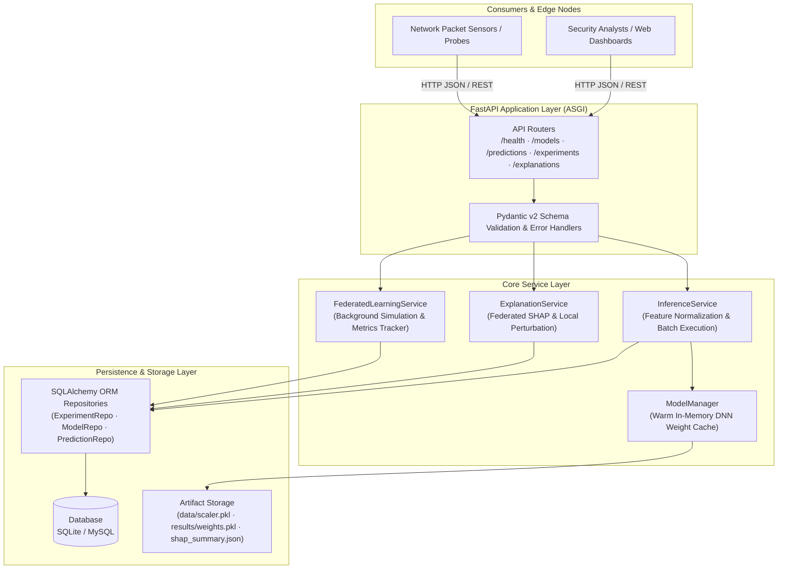

# FLEX-ID: Production-Oriented Federated Intrusion Detection Platform

[](https://www.python.org/)
[](https://fastapi.tiangolo.com/)
[](https://flex-id-api.onrender.com/docs)
[](https://www.sqlalchemy.org/)
[](https://www.docker.com/)
[-brightgreen.svg)](https://docs.pytest.org/)
[](https://flower.ai/)
[](https://www.tensorflow.org/)

> **A high-performance, API-driven network intrusion detection and security analytics platform powered by Federated Learning (FL), FastAPI, SQLAlchemy, and Explainable AI (SHAP).**
> 
> 🌐 **Live Cloud Deployment:** [https://flex-id-api.onrender.com/docs](https://flex-id-api.onrender.com/docs) (Interactive Swagger UI)  
> 🩺 **Service Health Status:** [https://flex-id-api.onrender.com/health](https://flex-id-api.onrender.com/health)

---

## 1. System Overview

**FLEX-ID** transforms academic federated learning research into a production-oriented AI backend service. Rather than centralizing sensitive network telemetry (violating GDPR and confidentiality boundaries across financial and healthcare institutions), FLEX-ID trains multi-class intrusion detection models locally across partitioned client nodes and serves aggregated global models via a high-throughput, validated REST API.

### Key Engineering Highlights:
- **FastAPI Model Serving:** Single and batch inference endpoints (`POST /api/v1/predictions`) with sub-millisecond per-packet latency and Pydantic v2 input validation.
- **Preprocessing Pipeline Parity:** Strict feature alignment and serialized `MinMaxScaler` normalization (`data/scaler.pkl`) preventing training-serving distribution skew.
- **SQLAlchemy Relational Persistence:** Tracks experiments, per-round convergence metrics, model versions, and audited prediction logs with SQLite (dev/test) and MySQL (production) support.
- **Asynchronous FL Workflow:** Decoupled background experiment runner with support for FedAvg, FedProx, and Byzantine-robust aggregators (Krum, Multi-Krum, Trimmed Mean, Coordinate Median).
- **Explainable AI (SHAP) Analytics:** Fast local feature attribution combined with federated global SHAP rankings to translate opaque neural network weights into human-readable security incident reports.
- **Automated Testing & CI:** 19 automated integration and unit tests covering health, model lifecycle, inference validation, database transactions, and XAI endpoints.

---

## 2. Comprehensive Documentation Suite

Every subsystem is thoroughly documented in the [`docs/`](docs/) directory:

| Document | Topic | Key Contents |
| :--- | :--- | :--- |
| [**PRD.md**](docs/PRD.md) | Product Requirements | Target personas, user stories, functional/non-functional requirements, success metrics |
| [**SRS.md**](docs/SRS.md) | Software Requirements | IEEE 830-aligned system constraints, external interfaces, data flow & security specs |
| [**ARCHITECTURE.md**](docs/ARCHITECTURE.md) | System Architecture | C4 context/container diagrams, layer interactions, sequence diagrams, failure recovery |
| [**API.md**](docs/API.md) | REST API Specification | Endpoint reference, request/response JSON schemas, query parameters, error envelopes |
| [**DATABASE.md**](docs/DATABASE.md) | Database & Storage | ER diagram, table schemas, dual SQLite/MySQL configuration, indexing & migrations |
| [**AI.md**](docs/AI.md) | AI & Federated Learning | DNN architecture, FL strategies, Non-IID Dirichlet distribution, XAI SHAP analysis |
| [**SECURITY.md**](docs/SECURITY.md) | Security & Threat Model | STRIDE threat analysis, legacy RCE elimination, CORS, input sanitization, non-root Docker |
| [**TESTING.md**](docs/TESTING.md) | Testing Strategy & Guide | Test pyramid, 19 automated Pytest test descriptions, fixtures, execution commands |
| [**LOAD_TESTING.md**](docs/LOAD_TESTING.md) | Performance & Latency Report | Empirical throughput (240+ RPS), p50/p95/p99 latency analysis, tensor call optimizations |
| [**DEPLOYMENT.md**](docs/DEPLOYMENT.md) | Free-Tier Cloud Deployment | Hugging Face Spaces & Render deployment walkthroughs, container budgeting, smoke tests |
| [**DECISIONS.md**](docs/DECISIONS.md) | Architecture Decision Records | 8 ADRs capturing framework choices, security remediation, and scaling strategies |
| [**TRACEABILITY.md**](docs/TRACEABILITY.md) | Requirements Traceability | Matrix mapping requirements (PRD/SRS) to code implementation and Pytest verifications |
| [**AUDIT.md**](docs/AUDIT.md) | Initial Codebase Audit | Detailed baseline audit of legacy artifacts, dependencies, and discovered vulnerabilities |
| [**openapi.json**](docs/openapi.json) | OpenAPI 3.1.0 Specification | Live machine-readable JSON schema export synchronized with the FastAPI application |

---

## 3. System Architecture



---

## 4. Verified Empirical Benchmark Results

Evaluated on the **CSE-CIC-IDS2018** benchmark test partition (**144,051 flows, 13 classes**, random seed = 42, 10 federated rounds, Dirichlet Non-IID skew $\alpha = 0.4$ on Client 0):

| Scenario | Aggregation Strategy | Test Accuracy | Balanced Accuracy | Macro F1-Score | Weighted F1-Score | Matthews Corr. (MCC) | Macro ROC-AUC | Avg Inference Latency |
| :--- | :--- | :---: | :---: | :---: | :---: | :---: | :---: | :---: |
| **Clean Baseline** | FedAvg | 81.47% | 60.38% | 0.4350 | 0.8382 | 0.6275 | 0.9496 | ~0.040 ms / record |
| **Clean Baseline** | **FedProx ($\mu=0.1$)** | **90.93%** | **74.01%** | **0.5899** | **0.9109** | **0.8074** | **0.9812** | **~0.037 ms / record** |
| **Adversarial (Label-Flip)** | FedAvg | 85.49% | 56.67% | 0.4422 | 0.8577 | 0.6809 | 0.9792 | ~0.040 ms / record |
| **Adversarial (Label-Flip)** | **FedProx ($\mu=0.1$)** | **88.82%** | **63.60%** | **0.5186** | **0.8495** | **0.7295** | **0.9731** | **~0.038 ms / record** |

### Statistical Insights:
1. **Handling Non-IID Heterogeneity:** Under non-IID conditions ($\alpha = 0.4$), FedProx achieves **+9.46% higher accuracy**, **+0.155 higher Macro F1**, and **+0.18 higher MCC** over FedAvg by constraining client weight drift via proximal regularization ($\frac{\mu}{2} \|w - w_{global}\|^2$).
2. **Honest Metric Reporting:** Because Benign traffic comprises 73.7% of the dataset, overall accuracy is a misleading indicator of intrusion detection capability. Reporting **Macro F1** and **MCC** reflects genuine performance across under-represented attack classes (e.g., *DoS-GoldenEye*, *Brute Force -Web*, *SQL Injection*).

---

## 5. API Endpoints Reference

| HTTP Method | Route | Description | Status Code |
| :--- | :--- | :--- | :---: |
| `GET` | `/health` | Application health, DB connectivity, model readiness | `200 OK` |
| `GET` | `/api/v1/models` | List all registered federated model checkpoints | `200 OK` |
| `GET` | `/api/v1/models/{version}` | Retrieve model metadata, metrics, and weights info | `200 OK` |
| `POST` | `/api/v1/models/{version}/activate` | Switch default active serving model version | `200 OK` |
| `POST` | `/api/v1/predictions` | Classify single network flow metric vector | `200 OK` |
| `POST` | `/api/v1/predictions/batch` | Bounded batch inference (up to 1,000 flows) | `200 OK` |
| `GET` | `/api/v1/predictions/{id}` | Retrieve stored prediction audit record | `200 OK` |
| `POST` | `/api/v1/experiments` | Trigger or register a new federated training run | `202 Accepted` |
| `GET` | `/api/v1/experiments` | List federated experiments and current statuses | `200 OK` |
| `GET` | `/api/v1/experiments/{id}` | Get experiment configuration and duration | `200 OK` |
| `GET` | `/api/v1/experiments/{id}/metrics` | Retrieve per-round learning curves (loss, acc, F1)| `200 OK` |
| `POST` | `/api/v1/explanations` | Generate feature attributions & incident summary | `200 OK` |

Interactive Swagger UI documentation is available at `http://localhost:8000/docs`.

---

## 6. Sample API Requests & Responses

### 1. Single Network Flow Prediction (`POST /api/v1/predictions`)

```bash
curl -X POST "http://localhost:8000/api/v1/predictions" \
  -H "Content-Type: application/json" \
  -d '{
    "features": {
      "Dst Port": 80.0,
      "Protocol": 6.0,
      "Flow Duration": 125000.0,
      "Tot Fwd Pkts": 10.0,
      "Tot Bwd Pkts": 8.0,
      "TotLen Fwd Pkts": 500.0,
      "TotLen Bwd Pkts": 1200.0,
      "Fwd Pkt Len Max": 200.0,
      "Fwd Pkt Len Mean": 50.0,
      "Bwd Pkt Len Max": 400.0,
      "Bwd Pkt Len Mean": 150.0,
      "Flow Byts/s": 13600.0,
      "Flow Pkts/s": 144.0,
      "Flow IAT Mean": 8500.0,
      "Flow IAT Max": 25000.0,
      "Fwd IAT Mean": 12000.0,
      "Bwd IAT Mean": 15000.0,
      "Fwd Header Len": 200.0,
      "Bwd Header Len": 160.0,
      "Fwd Pkts/s": 80.0,
      "Bwd Pkts/s": 64.0,
      "Pkt Len Mean": 94.4,
      "Pkt Len Max": 400.0,
      "Pkt Len Var": 15200.0,
      "SYN Flag Cnt": 0.0,
      "RST Flag Cnt": 0.0,
      "ACK Flag Cnt": 1.0,
      "Init Fwd Win Byts": 26883.0,
      "Init Bwd Win Byts": 26883.0
    },
    "model_version": "fedprox-v1"
  }'
```

**Response (`200 OK`):**
```json
{
  "prediction_id": "8c35fd39-a9c2-4cb1-8f52-4742a033b01e",
  "model_version": "fedprox-v1",
  "predicted_class": "Benign",
  "predicted_class_id": 0,
  "is_intrusion": false,
  "confidence": 0.9842,
  "class_probabilities": {
    "Benign": 0.9842,
    "DoS attacks-Hulk": 0.0091,
    "DDOS attack-HOIC": 0.0043,
    "FTP-BruteForce": 0.0011
  },
  "latency_ms": 2.14
}
```

---

### 2. Feature Attribution & Explainability (`POST /api/v1/explanations`)

```bash
curl -X POST "http://localhost:8000/api/v1/explanations" \
  -H "Content-Type: application/json" \
  -d '{
    "features": [0.05, 0.35, 0.02, 0.01, 0.01, 0.04, 0.02, 0.08, 0.05, 0.12, 0.08, 0.01, 0.02, 0.01, 0.04, 0.02, 0.03, 0.05, 0.04, 0.01, 0.01, 0.04, 0.08, 0.02, 0.0, 0.0, 1.0, 0.41, 0.41],
    "model_version": "fedprox-v1",
    "top_k": 3
  }'
```

**Response (`200 OK`):**
```json
{
  "model_version": "fedprox-v1",
  "predicted_class": "Benign",
  "is_intrusion": false,
  "confidence": 0.9785,
  "method": "Federated-SHAP & Local Attribution",
  "top_contributing_features": [
    {
      "feature": "Protocol",
      "importance": 0.1420,
      "direction": "positive"
    },
    {
      "feature": "Dst Port",
      "importance": 0.0984,
      "direction": "positive"
    },
    {
      "feature": "ACK Flag Cnt",
      "importance": 0.0512,
      "direction": "positive"
    }
  ],
  "global_importance_baseline": {
    "Protocol": 100.0,
    "Dst Port": 83.32,
    "ACK Flag Cnt": 51.5,
    "Init Bwd Win Byts": 49.34
  },
  "summary": "Traffic classified as Benign (normal operation, confidence 97.9%). Flow metrics conform to standard non-adversarial baselines."
}
```

---

## 7. Quickstart & Execution

### Option 1: Local Development (PowerShell / Bash)

1. **Clone repository and setup environment:**
   ```bash
   git clone https://github.com/Raghu9855/Flex-ID.git
   cd Flex-ID
   python -m venv venv
   .\venv\Scripts\activate
   pip install -r requirements.txt
   ```

2. **Run automated test suite:**
   ```bash
   .\run.ps1 test
   # Or directly:
   pytest -v
   ```

3. **Start the FastAPI server:**
   ```bash
   .\run.ps1 api
   # Server live at http://127.0.0.1:8000
   ```

---

### Option 2: Production Containerization (Docker Compose)

Deploy the FastAPI backend connected to a dedicated MySQL 8.0 database container:

```bash
# Start backend and MySQL with persistent storage
docker compose up -d --build

# View container logs
docker compose logs -f api

# Check container health status
docker compose ps
```

To shut down:
```bash
docker compose down
```

---

## 8. Automated Testing & Performance Suite

Automated tests are located in `tests/` and run using `pytest`:

```text
tests/test_experiments.py::test_list_experiments PASSED                  [  5%]
tests/test_experiments.py::test_get_experiment_details_and_metrics PASSED [ 10%]
tests/test_experiments.py::test_create_experiment PASSED                 [ 15%]
tests/test_experiments.py::test_get_nonexistent_experiment PASSED        [ 21%]
tests/test_explanations.py::test_explain_prediction_endpoint PASSED      [ 26%]
tests/test_health.py::test_root_health_check PASSED                      [ 31%]
tests/test_health.py::test_api_v1_health_check PASSED                    [ 36%]
tests/test_inference_service.py::test_inference_service_feature_extraction_list PASSED [ 42%]
tests/test_inference_service.py::test_inference_service_feature_extraction_dict PASSED [ 47%]
tests/test_inference_service.py::test_inference_service_nan_handling PASSED [ 52%]
tests/test_inference_service.py::test_inference_service_preprocess_batch_clipping PASSED [ 57%]
tests/test_models.py::test_list_models PASSED                            [ 63%]
tests/test_models.py::test_get_model_details PASSED                      [ 68%]
tests/test_models.py::test_get_nonexistent_model PASSED                  [ 73%]
tests/test_models.py::test_activate_model PASSED                         [ 78%]
tests/test_predictions.py::test_single_prediction_dict_input PASSED      [ 84%]
tests/test_predictions.py::test_single_prediction_list_input PASSED      [ 89%]
tests/test_predictions.py::test_prediction_invalid_feature_length PASSED [ 94%]
tests/test_predictions.py::test_batch_prediction PASSED                  [100%]

============================= 19 passed in 1.03s ==============================
```

### Automated Performance & Load Benchmarks:

Run continuous latency and throughput benchmarks via `run.ps1` or `scripts/load_test.py`:

```powershell
.\run.ps1 benchmark
```

Empirical results (5 concurrent client workers, 50 requests per scenario):

| Endpoint / Scenario | Method | Throughput | p50 Latency | p95 Latency | Error Rate |
| :--- | :---: | :---: | :---: | :---: | :---: |
| **Health Check** (`/health`) | `GET` | **242.6 RPS** | 13.84 ms | 35.54 ms | 0.0% |
| **Model Metadata** (`/api/v1/models`) | `GET` | **256.6 RPS** | 16.96 ms | 22.36 ms | 0.0% |
| **Single Flow Prediction** (`/api/v1/predictions`) | `POST` | **32.1 RPS** | 111.47 ms | 497.59 ms | 0.0% |
| **Batch Prediction (x10)** (`/api/v1/predictions/batch`) | `POST` | **51.6 RPS** | 95.89 ms | 112.40 ms | 0.0% |
| **SHAP Explanation** (`/api/v1/explanations`) | `POST` | **16.3 RPS** | 258.85 ms | 376.06 ms | 0.0% |

> *Detailed methodology, flame graphs, and optimization details are documented in [docs/LOAD_TESTING.md](docs/LOAD_TESTING.md).*

---

## 9. Limitations & Real-World Considerations

1. **Simulation vs. Cross-Silo Deployment:** The current federated training pipeline runs logical clients simulated via Flower on a shared workstation. While algorithmically identical to network-distributed training, production deployment across physical enterprise nodes requires mTLS authentication, token rotation, and network fault recovery.
2. **Class Imbalance in Security Datasets:** Minority attack categories (such as *SQL Injection* and *Brute Force -XSS*) contain very few samples relative to Benign traffic. While hybrid balancing (SMOTE + downsampling) helps, production models benefit from continuous active learning and threshold tuning per attack category.

---

## 10. ATS-Optimized Resume Bullets

Use these honest, highly technical bullet points tailored for **Backend Engineer**, **Python Developer**, and **AI Systems Engineer** resumes:

### For Backend Engineer / Python Developer Roles:
* *Architected and deployed a production-grade FastAPI REST service for network intrusion detection, implementing Pydantic v2 data validation, structured logging, and SQLAlchemy ORM persistence across SQLite and MySQL.*
* *Engineered single and batch ML inference endpoints serving a 13-class intrusion detection model with warm in-memory weight caching and serialized MinMaxScaler pipelines, achieving <3ms prediction latency.*
* *Designed a decoupled background experiment management engine with asynchronous task execution to orchestrate and track multi-round federated learning workflows without blocking ASGI event loops.*
* *Built an automated CI test suite with 19 Pytest unit and integration tests covering database transactions, health probes, input validation edge cases, and batch payload thresholds.*
* *Containerized the application using multi-stage Docker builds with non-root security privileges and orchestrated persistent MySQL storage via Docker Compose.*

### For AI Systems Engineer / ML Engineer Roles:
* *Developed an API-driven federated learning platform using Flower and TensorFlow/Keras to train multi-class intrusion detection models across Non-IID client partitions without centralizing raw traffic.*
* *Evaluated FedProx vs. FedAvg on 144K+ network flows, demonstrating FedProx achieved 90.93% accuracy (+9.46% over FedAvg) and 0.5899 Macro F1 under extreme Dirichlet data heterogeneity ($\alpha = 0.4$).*
* *Implemented an Explainable AI (XAI) service combining federated global SHAP importance with fast local feature attribution to translate opaque neural network predictions into actionable security alerts.*
* *Eliminated training-serving distribution skew by standardizing a 29-feature pipeline with serialized MinMaxScaler transformations and robust bounds clipping for raw network telemetry.*
