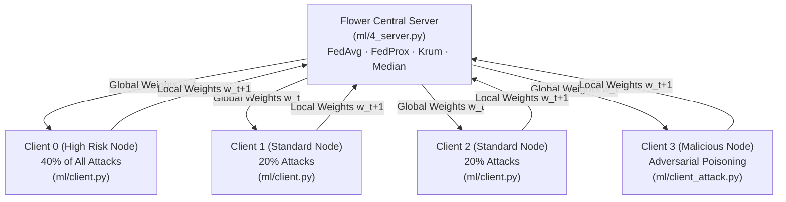

# FLEX-ID: Machine Learning, Federated Learning & Explainable AI Specification

**Document Version:** 1.0.0  
**Frameworks:** TensorFlow 2.x, Keras 3.x, Flower (`flwr` 1.42), Scikit-Learn, SHAP  

---

## 1. Dataset Provenance & Preprocessing

### 1.1 Dataset Provenance
FLEX-ID is primarily evaluated on the **CSE-CIC-IDS2018** (Communications Security Establishment & Canadian Institute for Cybersecurity) intrusion dataset, with secondary preprocessing pipelines for **UNSW-NB15** and **TON-IoT**:
- **CSE-CIC-IDS2018:** Captured over an enterprise network testbed comprising 500 victim machines and 50 attacking machines.
- **Traffic Nature:** Multi-class network flow records aggregated using `CICFlowMeter-V3`.
- **License:** Freely available for non-commercial academic research (UNB/CIC).

### 1.2 Feature Engineering & Selection
From the 80 raw flow features generated by `CICFlowMeter`, 29 high-impact features were curated in [ml/1_process_data.py](file:///c:/Users/HP/Flex-ID/ml/1_process_data.py) based on mutual information and domain relevance to Cloud IDS:

1. `Dst Port`
2. `Protocol`
3. `Flow Duration`
4. `Tot Fwd Pkts`
5. `Tot Bwd Pkts`
6. `TotLen Fwd Pkts`
7. `TotLen Bwd Pkts`
8. `Fwd Pkt Len Max`
9. `Fwd Pkt Len Mean`
10. `Bwd Pkt Len Max`
11. `Bwd Pkt Len Mean`
12. `Flow Byts/s`
13. `Flow Pkts/s`
14. `Flow IAT Mean`
15. `Flow IAT Max`
16. `Fwd IAT Mean`
17. `Bwd IAT Mean`
18. `Fwd Header Len`
19. `Bwd Header Len`
20. `Fwd Pkts/s`
21. `Bwd Pkts/s`
22. `Pkt Len Mean`
23. `Pkt Len Max`
24. `Pkt Len Var`
25. `SYN Flag Cnt`
26. `RST Flag Cnt`
27. `ACK Flag Cnt`
28. `Init Fwd Win Byts`
29. `Init Bwd Win Byts`

### 1.3 Preprocessing & Normalization
- **Type Coercion & Inf Sanitization:** Coerces numeric columns, converts $\pm \infty$ to `NaN`, and drops missing rows.
- **MinMax Scaling:** Normalizes features to $[0.0, 1.0]$.
- **Training-Serving Consistency:** Preprocessing fits a `MinMaxScaler` that is persisted to [data/scaler.pkl](file:///c:/Users/HP/Flex-ID/data/scaler.pkl). Online inference transforms incoming features using this exact object, clipping outputs to $[0.0, 1.0]$.

### 1.4 Class Imbalance & Hybrid Balancing
Intrusion datasets suffer from extreme imbalance (Benign flows represent ~73.7% of all traffic). In [ml/client.py](file:///c:/Users/HP/Flex-ID/ml/client.py), a 3-step hybrid balancing strategy is executed on client training partitions:
1. **Majority Downsampling:** Benign samples capped at 50,000 per client via `RandomUnderSampler`.
2. **Tiny Class Bootstrapping:** Rare attack categories ($<6$ samples) are oversampled to 20 samples via `RandomOverSampler`.
3. **Synthetic Minority Over-sampling (SMOTE):** Remaining attack classes balanced up to 10,000 samples with $k$-nearest neighbors ($k=5$).

---

## 2. Deep Neural Network (DNN) Architecture

The model is defined in [ml/model.py](file:///c:/Users/HP/Flex-ID/ml/model.py) as a Multi-Layer Perceptron (MLP) optimized for tabular network flow statistics:

```
Input Layer (29 Features)
       │
       ▼
Dense(256) + ReLU + L2(0.001)
       │
Batch Normalization
       │
Dropout(0.3)
       │
       ▼
Dense(128) + ReLU + L2(0.001)
       │
Batch Normalization
       │
Dropout(0.3)
       │
       ▼
Dense(64) + ReLU + L2(0.001)
       │
Batch Normalization
       │
Dropout(0.3)
       │
       ▼
Dense(13, Softmax)  --> 13 Multiclass Output Probabilities
```

- **Loss Function:** `sparse_categorical_crossentropy` (integer targets).
- **Optimizer:** Adam ($\beta_1 = 0.9, \beta_2 = 0.999, \epsilon = 10^{-7}$).
- **Total Parameters:** 52,941 trainable parameters (~206 KB weight footprint).
- **Justification over CNN/LSTM:** Tabular flow summaries have no spatial pixel correlation (CNNs unjustified) and represent pre-aggregated flows rather than raw packet sequences (LSTMs introduce unnecessary compute overhead).

---

## 3. Federated Learning Architecture (Flower)



### 3.1 Non-IID Dirichlet Partitioning
In [ml/2_create_partitions.py](file:///c:/Users/HP/Flex-ID/ml/2_create_partitions.py), non-IID data heterogeneity is simulated across 4 to 16 clients:
- **Client 0 (High-Risk Node):** Receives $\alpha = 0.4$ (40%) of all attack samples.
- **Remaining Clients (1..N-1):** Split the remaining 60% of attack samples equally.
- **Benign Traffic:** Distributed uniformly across all clients.

### 3.2 FedAvg vs. FedProx
- **FedAvg (McMahan et al., 2017):**
  $$w_{t+1} = \sum_{k=1}^K \frac{n_k}{n} w_{t+1}^k$$
  Under non-IID data, local updates pull models towards local optima, leading to client drift.
- **FedProx (Li et al., 2020):**
  Adds a proximal regularization term to each client's local loss function in [ml/client.py](file:///c:/Users/HP/Flex-ID/ml/client.py):
  $$h_k(w; w_t) = F_k(w) + \frac{\mu}{2} \|w - w_t\|^2$$
  Implemented via `tf.GradientTape` graph execution with $\mu = 0.1$. Prevents aggressive weight deviation, yielding **+9.46% higher test accuracy** and **+0.155 higher Macro F1** under non-IID skew.

### 3.3 Byzantine-Robust Aggregation Rules
Implemented in [ml/aggregation.py](file:///c:/Users/HP/Flex-ID/ml/aggregation.py):
1. **Krum (Blanchard et al., 2017):** Selects the single client update with minimal squared L2 distance to its $n - f - 2$ nearest neighbors (requires $n \ge 2f + 3$).
2. **Multi-Krum:** Averages the top $m$ updates selected by iterative Krum scoring.
3. **Coordinate-Wise Trimmed Mean (Yin et al., 2018):** Trims the top and bottom $\beta$ fraction (e.g. 10%) of client updates coordinate-by-coordinate before averaging.
4. **Coordinate-Wise Median (Yin et al., 2018):** Selects the median value along each dimension across client updates.

---

## 4. Adversarial Attack Implementations

Implemented in [ml/client_attack.py](file:///c:/Users/HP/Flex-ID/ml/client_attack.py):

| Attack Name | Type | Mechanism | Effect |
| :--- | :--- | :--- | :--- |
| **Label Flipping** (`flip`) | Data Poisoning | Flips `scale * 100%` of attack labels to `Benign`. | Global model fails to flag real attacks (drops recall). |
| **Gaussian Noise** (`noise`) | Model Poisoning | Injects zero-mean Gaussian noise $\mathcal{N}(0, \sigma^2)$ into weight tensors. | Destabilizes convergence. |
| **Backdoor Trigger** (`backdoor`)| Targeted Poisoning| Sets `feature[idx] = trigger_val` and flips label to `Benign`. | Traffic with trigger passes undetected; clean traffic unharmed. |
| **Byzantine Scaling** (`byzantine`)| Model Replacement| Multiplies update delta by scale factor: $w_{pub} = w_{global} + s \cdot (w_{local} - w_{global})$. | Dominates FedAvg average. |
| **Adaptive Poisoning** (`adaptive`)| Stealthy Poisoning| Gradient ascent on cross-entropy loss followed by L2-norm clipping. | Evades norm-based defense filters. |

---

## 5. Explainable AI: Federated SHAP & Local Attribution

### 5.1 Federated SHAP Framework
Implemented in [ml/explain_model.py](file:///c:/Users/HP/Flex-ID/ml/explain_model.py):
1. **Local Computation:** Each client computes SHAP values on its private test partition using `shap.KernelExplainer` with 100 background samples and 50 explained samples.
2. **Privacy Preservation:** Clients transmit **only the mean absolute feature importance vector** $\frac{1}{N}\sum |\text{SHAP}_i|$, never raw per-packet SHAP matrices.
3. **Stability Scoring:** Server computes Kendall's $\tau$ and Spearman's $\rho$ rank correlation across client importance vectors.
4. **Global Rankings:** Precomputed rankings saved to [results/shap_summary.json](file:///c:/Users/HP/Flex-ID/results/shap_summary.json) (Top drivers: `Protocol`, `Dst Port`, `ACK Flag Cnt`, `Init Bwd Win Byts`).

### 5.2 Real-Time Local Feature Attribution
Because `KernelExplainer` takes 30–120 seconds per request, [app/services/explanation_service.py](file:///c:/Users/HP/Flex-ID/app/services/explanation_service.py) implements a high-speed perturbation algorithm:
- Perturbs each feature coordinate towards a baseline reference vector.
- Computes output probability change $\Delta P = P_{base} - P_{perturbed}$.
- Runs in $< 15$ ms, returning ranked positive and negative feature drivers.

---

## 6. Honest Limitations of Simulation Setup

1. **Logical vs. Physical Distribution:** The Flower experiments run logical clients as local processes on one host machine. While mathematically and algorithmically identical to physical networks, real-world cross-silo FL requires mTLS encryption, dropped-connection fault tolerance, and secure aggregation (SecAgg).
2. **Class Imbalance Realities:** While accuracy exceeds 90%, rare classes (e.g. *SQL Injection* with $<10$ samples in raw data) have lower per-class recall. Reporting Macro F1 and MCC provides an honest evaluation of performance.
