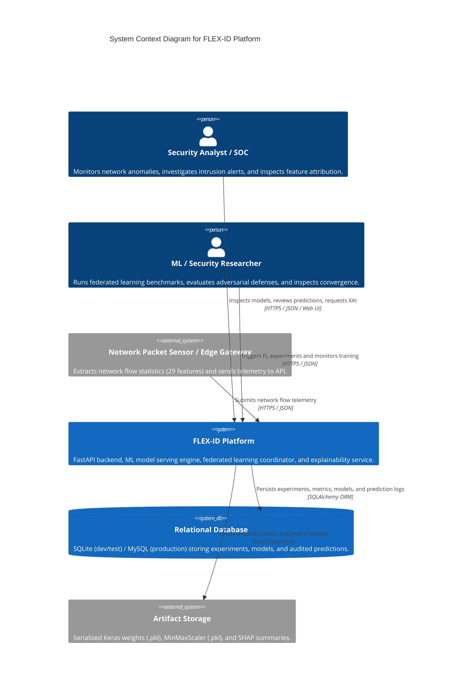
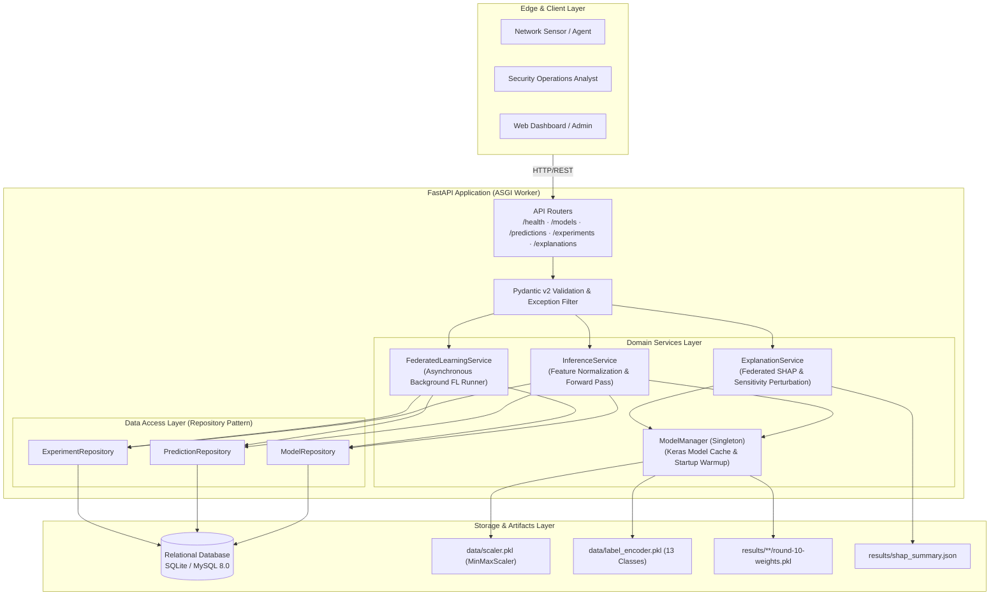
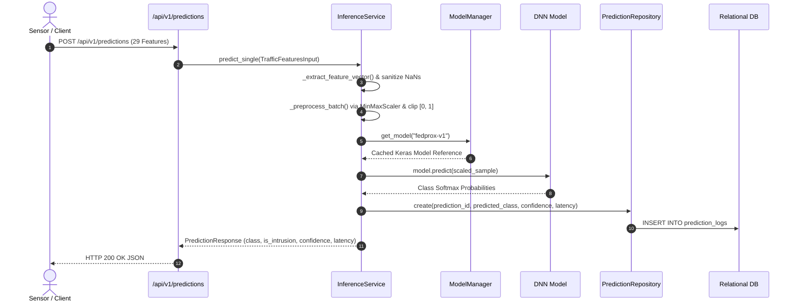
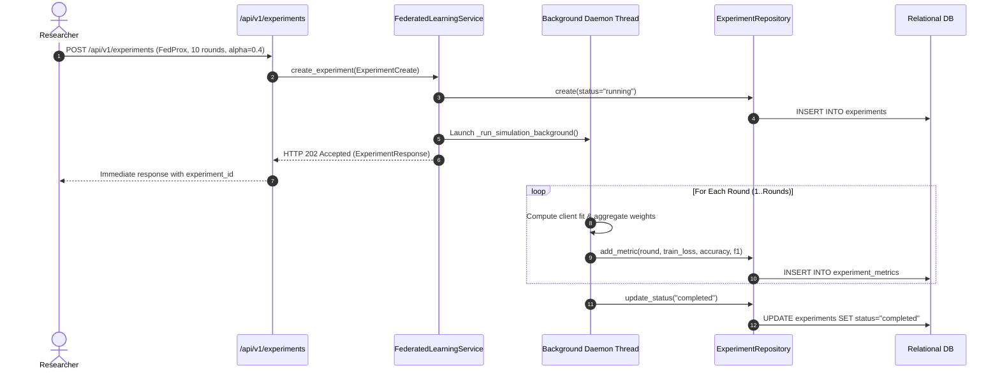

# FLEX-ID: System Architecture & Technical Design

**Document Version:** 1.0.0  
**Status:** Approved  
**Scope:** Backend Architecture, ML Serving, Federated Orchestration, and Persistence  

---

## 1. System Context Diagram (C4 Level 1)



---

## 2. Component & Container Diagram (C4 Level 2)



---

## 3. End-to-End Data Flows

### 3.1 Real-Time Prediction Request Flow


### 3.2 Asynchronous Federated Experiment Flow


---

## 4. Module Responsibilities & Separation of Concerns

1. **`app.api` (Transport Layer):** Validates HTTP contracts, maps query/path/body parameters, and returns status codes. Business logic is strictly excluded.
2. **`app.services` (Business Logic Layer):** Coordinates model execution, feature normalization, batching, perturbation calculations, and background simulation threads.
3. **`app.repositories` (Data Access Layer):** Encapsulates all raw SQLAlchemy queries, commits, and rollbacks. Decouples domain logic from SQL dialect differences.
4. **`app.models` & `app.schemas` (Contracts):**
   - `app.models`: SQLAlchemy ORM database table definitions.
   - `app.schemas`: Pydantic v2 schemas for request validation, serialization, and OpenAPI documentation.
5. **`ml` (Research & Training Pipeline):** Contains standalone Flower FL scripts, partition generators, and model architectures. Preserved intact for offline research and reproducible training.

---

## 5. Deployment Architecture & Trust Boundaries

```
[Untrusted Internet / Corporate LAN]
                │
                ▼ (Port 80 / 443 HTTPS)
   ┌─────────────────────────┐
   │ Reverse Proxy / Ingress │
   │   (Cloudflare / NGINX)  │
   └────────────┬────────────┘
                │ Port 8000 (HTTP)
                ▼ (TRUST BOUNDARY: Private VPC / Internal Container Network)
   ┌─────────────────────────────────────────────────────────────┐
   │                FLEX-ID Application Container                │
   │  Non-root user: appuser (UID 1001)                          │
   │  Uvicorn ASGI Server · FastAPI Application                  │
   └────────────────────────────┬────────────────────────────────┘
                                │ Port 3306 (TCP)
                                ▼
   ┌─────────────────────────────────────────────────────────────┐
   │                  MySQL 8.0 Database Container               │
   │  Persistent Volume: mysql_data                             │
   └─────────────────────────────────────────────────────────────┘
```

### Trust Boundary Protections:
- **Container Isolation:** API runs as a non-privileged system user (`appuser`, UID 1001).
- **Network Boundaries:** Database port 3306 is not exposed to the public internet; accessible only over the internal bridge network.
- **Input Boundaries:** Strict Pydantic validation rejects un-canonical feature shapes before touching the neural network runtime.
